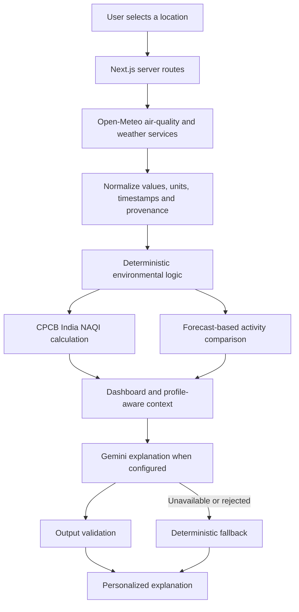

# AirAware AI V2 — Urban Air Quality Assistant

> **Same air. Different people. Personal answers.**
>
> AirAware AI turns regional air-quality and weather data into understandable, age-aware guidance for everyday outdoor decisions.

<p align="center">
  <a href="https://airaware-ai-omega.vercel.app/"><strong>Live Demo</strong></a>
  ·
  <a href="https://github.com/yakash03/airaware-ai"><strong>Source Code</strong></a>
  ·
  <a href="ARCHITECTURE.md"><strong>Architecture</strong></a>
  ·
  <a href="docs/CHALLENGE_ALIGNMENT.md"><strong>PromptWars Challenge 6</strong></a>
</p>

## Project at a glance

**AirAware AI** is an urban air-quality assistant built for **PromptWars Challenge 6: Urban Air Quality Assistant**. It combines environmental data, a deterministic Indian National Air Quality Index (NAQI) calculation pipeline, and a grounded generative-AI assistant to help people interpret air conditions in the context of age groups and daily activities.

Traditional AQI interfaces often present a number and a generic category. AirAware AI aims to make that information more useful: it explains what the available data represents, highlights its limitations, and presents practical, non-medical guidance in accessible language.

**Important data distinction:** the live air-quality values used by this project come from the Open-Meteo air-quality service using CAMS atmospheric modelling. They are regional model estimates, not measurements from a sensor installed at the user's exact location. The application must not be interpreted as a street-level monitoring instrument or medical device.

## Live application

- **Production deployment:** https://airaware-ai-omega.vercel.app/
- **GitHub repository:** https://github.com/yakash03/airaware-ai
- **Demo video:** Add the public video URL here when it is ready.

## Why this project matters

Air pollution is not experienced in the same way by everyone. A child playing outdoors, a student commuting, an adult travelling to work, and an older person going for a walk may need different explanations and activity considerations.

AirAware AI is designed around three ideas:

1. **One environmental snapshot:** preserve the same underlying pollutant values and AQI result for all profiles.
2. **Different explanations:** adapt language, accessibility, and general activity guidance to the selected age group.
3. **Transparent reasoning:** show whether information is model-estimated or forecast, explain the basis for recommendations, and communicate uncertainty.

The application does not diagnose health conditions or determine whether an activity is medically safe for an individual.

## Challenge 6 alignment: Urban Air Quality Assistant

| Urban air-quality need | AirAware AI implementation |
|---|---|
| Understand current air conditions | Dashboard using Open-Meteo air-quality data |
| Interpret pollution levels | Deterministic India NAQI calculation using CPCB 2014 breakpoints |
| Understand key pollutants | Displays PM2.5, PM10, CO, NO₂, SO₂ and O₃ where returned by the provider |
| Consider weather context | Weather information such as temperature, humidity, wind and precipitation |
| Make information understandable | Age-adapted family profiles and explanations |
| Ask follow-up questions | Gemini-powered conversational assistant with a deterministic fallback |
| Consider outdoor timing | 24-hour forecast-based comparative activity window |
| Understand data reliability | Data provenance, timestamps, model/forecast labels and limitations |
| Support a wider audience | English, Tamil and Hindi interface support; accessibility controls |

See [docs/CHALLENGE_ALIGNMENT.md](docs/CHALLENGE_ALIGNMENT.md) for the detailed feature-to-challenge mapping and evaluation notes.

## Key capabilities

### 1. Air-quality and weather dashboard

- Retrieves air-quality information from Open-Meteo's CAMS-based service.
- Presents pollutant values including PM2.5, PM10, CO, NO₂, SO₂ and O₃ when available in the API response.
- Calculates India's National AQI (NAQI) using deterministic CPCB 2014 breakpoint logic.
- Identifies the dominant pollutant from the calculated pollutant sub-indices.
- Displays weather context and data freshness/provenance information.
- Supports location search and city selection.

### 2. Age-aware family profiles

- Supports child, teen, adult and senior profile categories.
- Allows family profiles to be managed in the browser.
- Adapts explanation style and general activity considerations to the selected profile.
- Keeps the underlying environmental readings consistent across profiles.
- Stores profile information in browser `localStorage`; the documented design does not require a user account.

### 3. Ask AirAware AI

- Uses **Google Gemini 2.0 Flash** through server-side application routes when a Gemini API key is configured.
- Provides conversational explanations grounded in the environmental context supplied by the application.
- Uses output validation to check generated content against trusted input data and project safety rules.
- Provides a deterministic explanation fallback when Gemini is unavailable, times out, is rate-limited, or is not configured.
- Supports English, Tamil and Hindi experiences.

**Role separation:** the deterministic application logic calculates AQI and selects rule-based results. Gemini is used to explain the supplied context; it is not the source of pollutant measurements, CPCB thresholds, or calculated AQI values.

### 4. Forecast-based outdoor activity planner

- Examines the available hourly forecast window.
- Compares forecast conditions to identify a comparatively more favourable time window for selected outdoor activities.
- Presents the forecast context and rationale to the user.
- Communicates that forecast values are estimates and that a more favourable forecast period is not a guarantee of safe conditions.

### 5. Indoor air guidance

- Provides general household guidance based on the user's indoor-space answers and available outdoor conditions.
- Does **not** claim to measure indoor PM2.5, indoor AQI, or indoor gas concentrations.
- Clearly communicates that indoor measurements require compatible hardware sensors.

### 6. Accessibility and localization

- English, Tamil and Hindi language support.
- Text-size controls and high-contrast presentation.
- Senior-oriented display adjustments.
- Environmental units and pollutant labels are intended to remain clear across localized explanations.

## How the system works



### Data and AI responsibilities

| Component | Responsibility |
|---|---|
| Open-Meteo Air Quality API | Supplies CAMS-based air-quality model data |
| Open-Meteo Weather API | Supplies weather and forecast context |
| Open-Meteo Geocoding API | Resolves location searches |
| Deterministic AQI engine | Applies CPCB NAQI calculation rules |
| Forecast/activity logic | Compares forecast values using application rules |
| Google Gemini 2.0 Flash | Generates natural-language explanations from supplied context |
| Output validator | Checks generated responses against application constraints |
| Deterministic fallback | Keeps core explanations available without a successful Gemini response |

## Technology stack

| Layer | Technology |
|---|---|
| Framework | Next.js 16 App Router |
| UI | React 19 |
| Language | TypeScript |
| Styling | Tailwind CSS v4 |
| Generative AI | Google Gemini 2.0 Flash |
| Environmental data | Open-Meteo Air Quality, Weather and Geocoding APIs |
| AQI methodology | CPCB India National AQI, 2014 |
| Client-side profile storage | Browser `localStorage` |
| Deployment | Vercel |
| Tests | Node.js test scripts in `tests/` |

## Data sources and methodology

- **Air quality:** Open-Meteo Air Quality API, using Copernicus Atmosphere Monitoring Service (CAMS) model data.
- **Weather:** Open-Meteo Weather API.
- **Geocoding:** Open-Meteo Geocoding API.
- **Indian AQI:** Central Pollution Control Board (CPCB), *National Air Quality Index*, October 2014.
- **Health-context reference:** World Health Organization (WHO), *Global Air Quality Guidelines* (2021).

Check the upstream providers and source documents for current availability, licensing, model details and methodology. Data availability and returned fields can vary by location and time.

## Reliability, privacy and safety

- **Model estimates are not ground-station measurements.** CAMS data has regional spatial resolution and cannot describe every street-level pollution variation.
- **Forecasts are uncertain.** Future conditions may differ from the forecast.
- **No indoor sensor is claimed.** Indoor advice is not an indoor measurement.
- **No medical diagnosis.** AirAware AI provides general environmental information, not personal medical advice.
- **AI does not calculate AQI.** Numerical AQI calculations and thresholds belong to deterministic application logic.
- **Profile privacy.** Family profiles are stored in browser local storage according to the documented implementation. Users sharing a device should consider that local browser data may be visible to other people using that browser.
- **API key handling.** Configure the Gemini key only as a server-side environment variable. Never commit real API keys or secrets to the repository.

## Local setup

### Requirements

- Node.js version compatible with the installed Next.js release.
- npm.

### 1. Clone the repository

```bash
git clone https://github.com/yakash03/airaware-ai.git
cd airaware-ai
npm install
```

### 2. Configure environment variables

Copy the example file:

```bash
cp .env.example .env.local
```

If using Gemini, set the server-side key in `.env.local`:

```env
GEMINI_API_KEY=your_gemini_api_key
```

Do not commit `.env.local` or any real secret. The Gemini key is optional according to the project documentation; without it, the deterministic explanation fallback is intended to handle supported explanation flows.

### 3. Run locally

```bash
npm run dev
```

Open http://localhost:3000.

### 4. Run the documented test suites

```bash
node tests/run_tests.mjs
node tests/phase3_tests.mjs
node tests/phase4_tests.mjs
node tests/phase5_tests.mjs
```

The repository README previously documented **59 passing tests** across these four scripts. Re-run the commands on the current commit before quoting that result in a competition submission; test status can change as code changes.

### 5. Build for production

```bash
npm run build
npm run start
```

## Deployment

The project is deployed at:

https://airaware-ai-omega.vercel.app/

For a Vercel deployment:

1. Import `yakash03/airaware-ai` into Vercel.
2. Configure `GEMINI_API_KEY` as a server-side environment variable if Gemini functionality is required.
3. Deploy the project.
4. Verify the live dashboard, location search, profile flows, chat fallback, and forecast planner.
5. Confirm that the deployed commit matches the GitHub commit being submitted.

## Known limitations

1. CAMS-based data is regional model output, not a hyperlocal roadside sensor reading.
2. Forecast accuracy varies with location, time horizon and atmospheric conditions.
3. Indoor air quality cannot be measured without compatible indoor hardware.
4. Personalized explanations are general guidance based on age categories, not individualized medical advice.
5. Gemini output depends on API availability and configured service limits; the deterministic fallback is intended to preserve supported explanation functionality.

## Repository documentation

- [System architecture](ARCHITECTURE.md)
- [Development progress](DEVELOPMENT_PROGRESS.md)
- [PromptWars Challenge 6 alignment](docs/CHALLENGE_ALIGNMENT.md)

## Project status

AirAware AI V2 is deployed as a working web application. The repository includes implementation, architecture and test documentation. Please use the live deployment and the current source code to verify each feature before evaluating it.

---

**Built for PromptWars Challenge 6 — Urban Air Quality Assistant.**
